# How Node.js Works Under the Hood: An Architecture Deep Dive

> **Source:** Adapted and expanded from Piyush Garg's video *"How NodeJS Works? – You don't Know NodeJS"* (originally in Hindi), cross-checked against the official guide [The Node.js Event Loop](https://nodejs.org/learn/asynchronous-work/event-loop-timers-and-nexttick).
>
> **Level:** Intermediate to Advanced
>
> **Verified on:** Node.js `v24.11.0`. Every output shown below came from actually running the code.
>
> **Animations:** the animated PNGs (APNG) in `assets/` are generated by `scripts/generate_animations.py`. To rebuild them, run `python scripts/generate_animations.py` (requires Pillow).

---

## Table of Contents

1. [Overview](#1-overview)
2. [Core Architecture: V8 + libuv](#2-core-architecture-v8--libuv)
3. [What Happens When You Run `node index.js`](#3-what-happens-when-you-run-node-indexjs)
4. [The Event Loop: Phases and Lifecycle](#4-the-event-loop-phases-and-lifecycle)
5. [Microtasks vs. Macrotasks](#5-microtasks-vs-macrotasks)
6. [Execution Order Walkthroughs (Examples from the Video)](#6-execution-order-walkthroughs-examples-from-the-video)
7. [Thread Pool Deep Dive](#7-thread-pool-deep-dive)
8. [Node.js vs. Thread-per-Request Servers (PHP)](#8-nodejs-vs-thread-per-request-servers-php)
9. [Summary and Key Takeaways](#9-summary-and-key-takeaways)

---

## 1. Overview

Node.js is **not a programming language**. It is a **JavaScript runtime environment** that lets JavaScript run outside the browser. It is built from two major components:

| Component | Written in | Responsibility |
|---|---|---|
| **V8** | C++ (it executes JavaScript) | Parses, compiles, and executes your JavaScript code |
| **libuv** | C | Provides the **Event Loop** and the **Thread Pool**, which handle asynchronous, non-blocking I/O |

Your JavaScript runs on a **single main thread**. Node.js still handles thousands of concurrent operations because:

- The **event loop** schedules callbacks without ever blocking that main thread.
- Slow or heavy work (file system, crypto, compression, DNS lookups) is **offloaded** to the **libuv thread pool** or to the **OS kernel**.
- When that work finishes, its callback is queued and later run on the main thread.

```
 ┌──────────────────────────── Node.js ────────────────────────────┐
 │                                                                  │
 │        ┌─────────────────┐          ┌──────────────────────┐     │
 │        │       V8        │          │        libuv         │     │
 │        ├─────────────────┤          ├──────────────────────┤     │
 │        │  C++            │          │  Event Loop          │     │
 │        │  JavaScript     │          │  Thread Pool         │     │
 │        └─────────────────┘          └──────────────────────┘     │
 └──────────────────────────────────────────────────────────────────┘
```

---

## 2. Core Architecture: V8 + libuv

### 2.1 High-Level Architecture

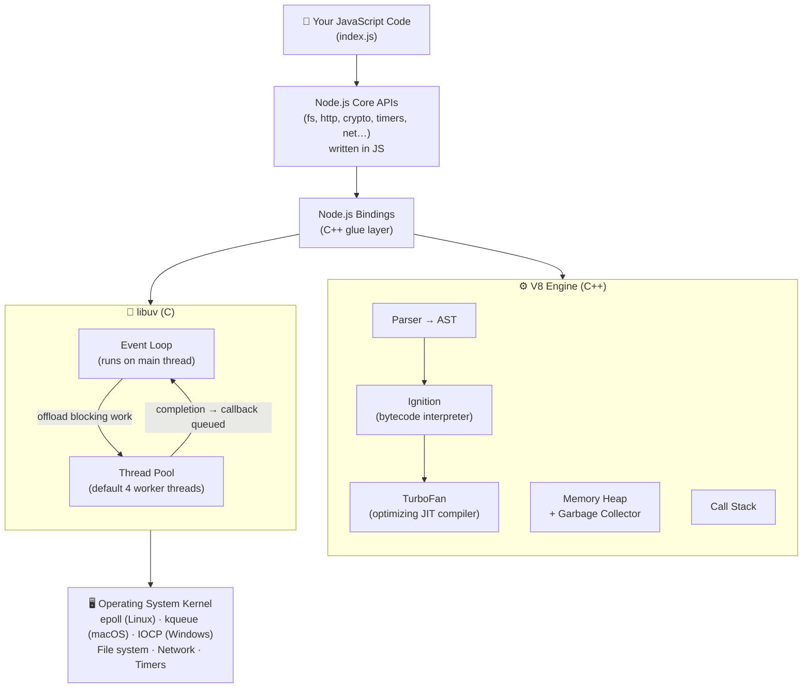

### 2.2 The V8 JavaScript Engine

V8 is the open-source JavaScript engine Google built for **Chrome**. Node.js embeds the same engine, which is what actually executes your JavaScript.

**What V8 does:**

| Part | Role |
|---|---|
| **Parser** | Turns source code into an Abstract Syntax Tree (AST). |
| **Ignition (interpreter)** | Compiles the AST to bytecode and starts executing immediately. |
| **TurboFan (JIT compiler)** | Watches for "hot" functions and recompiles them into highly optimized machine code. |
| **Memory Heap** | Where objects, closures, and arrays are allocated. |
| **Garbage Collector (Orinoco)** | Frees unreachable memory using a generational model (young and old generation). |
| **Call Stack** | Tracks which function is running right now. JS is single-threaded, so there is **one call stack**. |

**C++ and JavaScript integration.** V8 is written in C++, and Node.js exposes C++ functionality to JavaScript through **bindings**. When you call `fs.readFile()`, the call goes:

```
JS (lib/fs.js) ──► C++ binding (node_file.cc) ──► libuv (uv_fs_read) ──► OS
```

> [!IMPORTANT]
> V8 only knows the ECMAScript language: variables, functions, Promises, and so on. It has **no idea** what a file, a socket, or `setTimeout` is. Those capabilities come from **Node.js plus libuv**. In the browser, the same job is done by Web APIs.

**How V8 runs a simple script:**

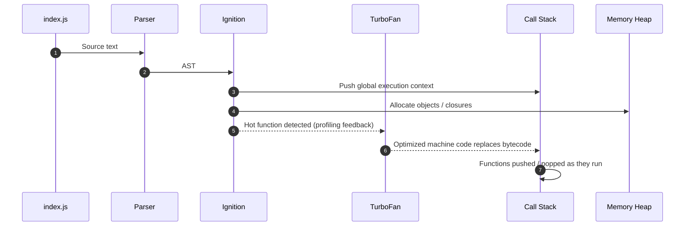

### 2.3 libuv

**libuv** is a cross-platform C library that implements:

1. **The Event Loop**, which decides *when* each callback runs.
2. **The Thread Pool**, a set of worker threads for operations the OS cannot do asynchronously.

**Platform independence.** Each OS has its own async I/O mechanism. libuv hides those differences behind one API:

| OS | Mechanism used by libuv |
|---|---|
| Linux | `epoll` |
| macOS / BSD | `kqueue` |
| Windows | IOCP (I/O Completion Ports) |
| SunOS | event ports |

**Who handles what:**

| Operation | Handled by |
|---|---|
| TCP/UDP sockets, HTTP servers, pipes | **OS kernel** (async natively, so no thread pool) |
| Timers (`setTimeout`, `setInterval`) | **Event loop** (timer heap) |
| File system (`fs.*` async APIs) | **Thread pool** |
| `crypto.pbkdf2`, `scrypt`, `randomBytes`, `randomFill`, `generateKeyPair` | **Thread pool** |
| `zlib` async compression | **Thread pool** |
| `dns.lookup()` | **Thread pool** (`dns.resolve*()` uses the network instead) |

---

## 3. What Happens When You Run `node index.js`

```js
// index.js
console.log("Hey from Node.js");
```

```bash
$ node index.js
Hey from Node.js
```

When you run this command, Node.js creates a **Node process**. That process has **one main thread** where your code and the event loop run, plus a **thread pool** waiting in the background.

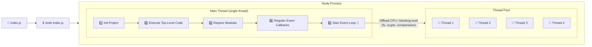

### The startup steps

| # | Step | What it means |
|---|---|---|
| 1 | **Init Project** | Node bootstraps itself: it initializes V8 and libuv and sets up `process`, `globalThis`, and so on. |
| 2 | **Execute Top-Level Code** | Runs everything written directly in the file and **not inside a function or callback**. |
| 3 | **Require Modules** | Loads modules such as `require('fs')`. In practice this happens as each `require` line is reached during top-level execution. |
| 4 | **Register Event Callbacks** | Callbacks such as `server.on('request')`, `socket.on('close')`, and timer callbacks are **registered, not executed**. |
| 5 | **Start Event Loop** | The loop begins processing queued callbacks phase by phase. |

**What counts as top-level code?**

```js
const fs = require("fs");          // ✅ top-level
let a = 24;                        // ✅ top-level
console.log("Hello");              // ✅ top-level

setTimeout(() => {                 // ✅ calling setTimeout (starting the timer) is top-level
  console.log("Inside timer");     // ❌ NOT top-level, this is a callback
}, 0);

function greet() {
  console.log("Hi");               // ❌ NOT top-level, this is inside a function
}
```

---

## 4. The Event Loop: Phases and Lifecycle

### 4.1 Simplified model (as drawn in the video)

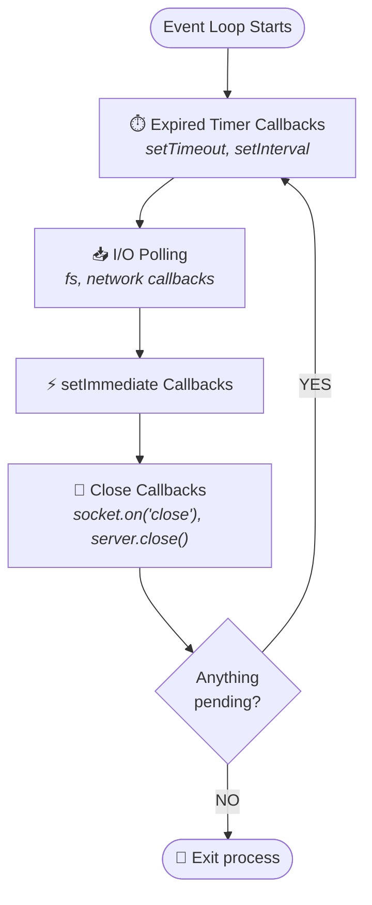

### 4.2 The full libuv model (official Node.js docs)

The video groups some phases together. The official model has **six phases**, and each phase has its **own FIFO queue** of callbacks.

```
   ┌───────────────────────────┐
┌─>│           timers          │  ← setTimeout / setInterval callbacks
│  └─────────────┬─────────────┘
│  ┌─────────────┴─────────────┐
│  │     pending callbacks     │  ← deferred system I/O callbacks (e.g. TCP errors)
│  └─────────────┬─────────────┘
│  ┌─────────────┴─────────────┐
│  │       idle, prepare       │  ← internal use only
│  └─────────────┬─────────────┘      ┌───────────────┐
│  ┌─────────────┴─────────────┐      │   incoming:   │
│  │           poll            │<─────┤  connections, │
│  └─────────────┬─────────────┘      │   data, etc.  │
│  ┌─────────────┴─────────────┐      └───────────────┘
│  │           check           │  ← setImmediate callbacks
│  └─────────────┬─────────────┘
│  ┌─────────────┴─────────────┐
└──┤      close callbacks      │  ← 'close' events
   └───────────────────────────┘
```

### 4.3 The complete cycle, including microtasks

The microtask queues are **not a phase**. They are drained **after every single callback**, in every phase.

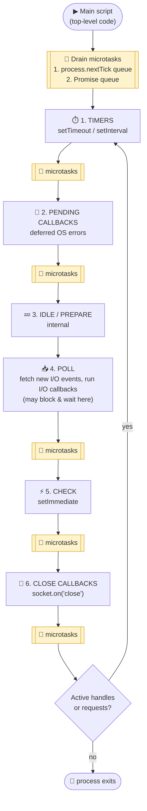

**Animated:** the loop runs the main script once, then cycles through each phase, with microtask checkpoints (μ) between them, until nothing is pending:

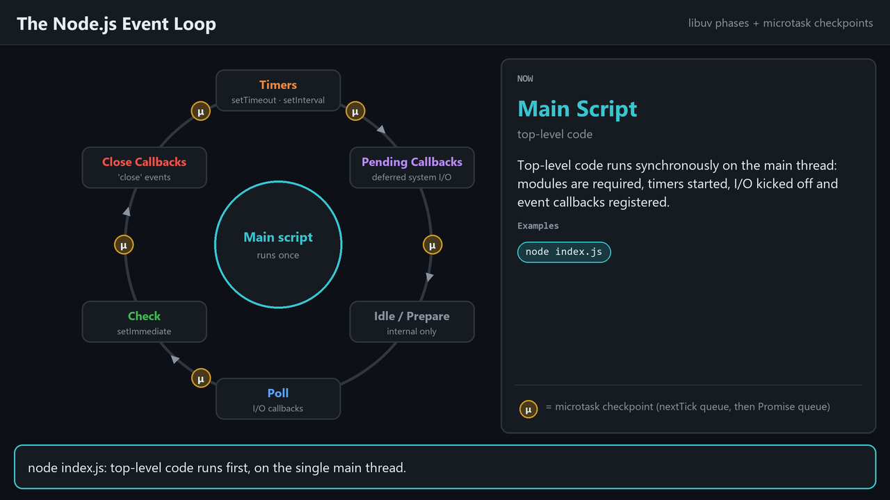

### 4.4 The phases in detail

| # | Phase | What runs here | Notes |
|---|---|---|---|
| 1 | **Timers** | Callbacks from `setTimeout()` / `setInterval()` whose threshold has passed | A timer delay is a **minimum**, not an exact time. `setTimeout(fn, 0)` is coerced to **1 ms**. |
| 2 | **Pending callbacks** | I/O callbacks deferred from the previous iteration | For example, `ECONNREFUSED` on some *nix systems. |
| 3 | **Idle, prepare** | Internal libuv housekeeping | Not reachable from user code. |
| 4 | **Poll** | Retrieves new I/O events and runs their callbacks (fs, network, and so on) | If the queue is empty and nothing is scheduled with `setImmediate`, the loop **blocks here** and waits for I/O, up to the next timer's deadline. |
| 5 | **Check** | `setImmediate()` callbacks | Always runs right after poll. |
| 6 | **Close callbacks** | `'close'` events, such as after `socket.destroy()` | |

> [!NOTE]
> **libuv 1.45 / Node.js 20+ change:** according to the official docs, timers now run **after** the poll phase in each iteration. In earlier versions they ran before it. For backward compatibility, libuv still runs timers **once before entering the loop**, so the classic diagram above is still the right mental model for almost every case.

### 4.5 Poll phase decision logic

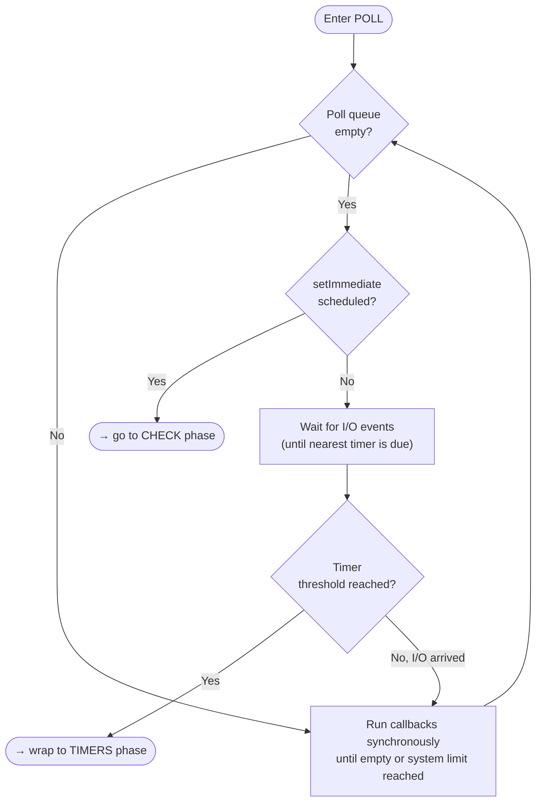

---

## 5. Microtasks vs. Macrotasks

### 5.1 Definitions

| Type | Queue | Scheduled by | When it runs |
|---|---|---|---|
| **Microtask** (highest priority) | `nextTickQueue` | `process.nextTick()` | Right after the current operation, **before** Promise microtasks |
| **Microtask** | Promise / microtask queue (V8) | `Promise.then/catch/finally`, `await`, `queueMicrotask()` | After the `nextTick` queue is empty |
| **Macrotask** | Timers queue | `setTimeout`, `setInterval` | Timers phase |
| **Macrotask** | Poll queue | I/O callbacks | Poll phase |
| **Macrotask** | Check queue | `setImmediate` | Check phase |
| **Macrotask** | Close queue | `'close'` handlers | Close phase |

### 5.2 Priority ladder

```
 HIGHEST ▲   1. Synchronous code (call stack)
         │   2. process.nextTick queue      ┐
         │   3. Promise microtask queue     ┘ drained completely after EVERY callback
         │   4. Timers         (setTimeout / setInterval)
         │   5. Poll           (I/O callbacks)
         │   6. Check          (setImmediate)
 LOWEST  ▼   7. Close callbacks
```

### 5.3 How callbacks move between queues

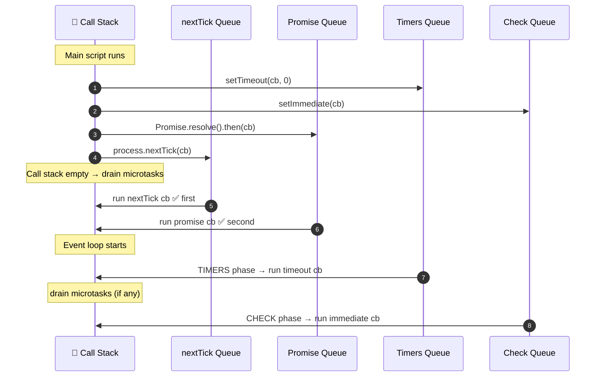

### 5.4 Queue snapshots, step by step

For this script:

```js
console.log("A");
setTimeout(() => console.log("B"), 0);
setImmediate(() => console.log("C"));
Promise.resolve().then(() => console.log("D"));
process.nextTick(() => console.log("E"));
console.log("F");
```

| Step | Call Stack | nextTick Q | Promise Q | Timers Q | Check Q | Output so far |
|---|---|---|---|---|---|---|
| 1 | `log("A")` | – | – | – | – | `A` |
| 2 | `setTimeout` | – | – | `B` | – | `A` |
| 3 | `setImmediate` | – | – | `B` | `C` | `A` |
| 4 | `Promise.then` | – | `D` | `B` | `C` | `A` |
| 5 | `nextTick` | `E` | `D` | `B` | `C` | `A` |
| 6 | `log("F")` | `E` | `D` | `B` | `C` | `A F` |
| 7 | *(drain nextTick)* | – | `D` | `B` | `C` | `A F E` |
| 8 | *(drain promises)* | – | – | `B` | `C` | `A F E D` |
| 9 | *Timers phase* | – | – | – | `C` | `A F E D B`* |
| 10 | *Check phase* | – | – | – | – | `A F E D B C`* |

\* Outside an I/O cycle, the order of `B` and `C` is **non-deterministic**. See [Example 2](#example-2-the-catch-remove-one-consolelog-and-the-order-flips).

**Animated:** the same steps, showing each callback moving through the queues:

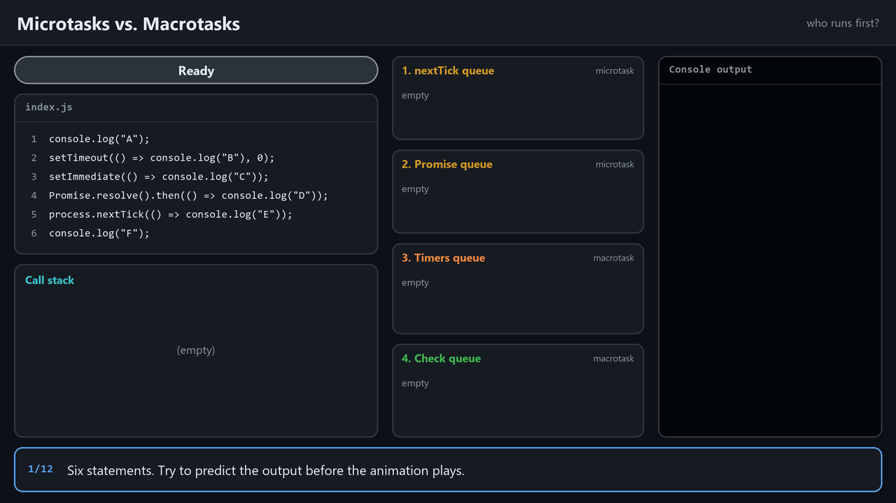

> [!NOTE]
> **Node.js ≥ 11 behavior.** The video describes Promise callbacks as running *"whenever the event loop transitions from one phase to another."* That was true **before Node 11**. Since Node 11, microtasks are drained **after each individual callback**, even inside the same phase, which matches browser behavior. Verified:
>
> ```js
> setTimeout(() => {
>   console.log("timeout 1");
>   Promise.resolve().then(() => console.log("promise inside timeout 1"));
>   process.nextTick(() => console.log("nextTick inside timeout 1"));
> }, 0);
> setTimeout(() => console.log("timeout 2"), 0);
> ```
>
> ```text
> timeout 1
> nextTick inside timeout 1
> promise inside timeout 1
> timeout 2
> ```

> [!WARNING]
> **Starvation:** recursively calling `process.nextTick()`, or chaining Promises endlessly, keeps the microtask queue from ever emptying. The loop then never reaches the **poll** phase, so all I/O is starved. The official docs recommend **`setImmediate()` in most cases** because it is easier to reason about.

### 5.5 `process.nextTick()` vs `setImmediate()`: the naming quirk

| API | Actually fires… |
|---|---|
| `process.nextTick()` | **Immediately**, after the current operation, in the *same* phase |
| `setImmediate()` | On the **next iteration** of the loop (check phase) |

In the official docs' words, *"the names should be swapped."* They stay as they are for backward compatibility.

---

## 6. Execution Order Walkthroughs (Examples from the Video)

### Example 1: Top-level code vs. timer

```js
const fs = require("fs");

setTimeout(() => console.log("Hello from Timer 1"), 0);

console.log("Hello from top-level code");
```

**Output:**

```text
Hello from top-level code
Hello from Timer 1
```

**Why:**

1. Top-level code runs on the main thread. It **starts** the timer and logs `Hello from top-level code`.
2. The event loop starts. In the **Timers** phase the 0 ms timer has expired, so its callback runs.
3. No I/O, no immediates, no close callbacks, nothing pending, so the process **exits**.

---

### Example 2: The catch. Remove one `console.log` and the order flips

**Version A, with a top-level `console.log`:**

```js
const fs = require("fs");

setTimeout(() => console.log("Hello from Timer 1"), 0);
setImmediate(() => console.log("Hello from Immediate Fn 1"));

console.log("Hello from top-level code");
```

```text
Hello from top-level code
Hello from Timer 1
Hello from Immediate Fn 1
```

**Version B, with the `console.log` removed:**

```js
const fs = require("fs");

setTimeout(() => console.log("Hello from Timer 1"), 0);
setImmediate(() => console.log("Hello from Immediate Fn 1"));
```

```text
Hello from Immediate Fn 1     ← may come first!
Hello from Timer 1
```

**Why does this happen?** In the main module (not inside an I/O callback), the official docs say:

> *"The order in which the two timers are executed is **non-deterministic**, as it is bound by the performance of the process."*

The mechanics:

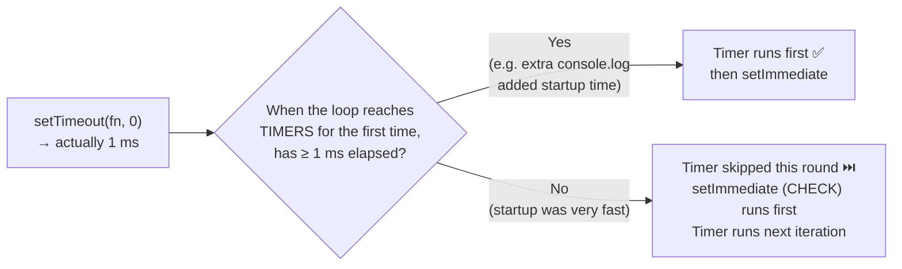

- `setTimeout(fn, 0)` is really `setTimeout(fn, 1)`.
- If the process reaches the timers phase **in under 1 ms**, the timer has not expired yet. The loop moves on to **check**, so `setImmediate` runs first.
- A synchronous `console.log` writing to the terminal adds enough delay that the 1 ms has usually passed, so the **timer wins**.
- The result depends on machine load, so **never rely on this ordering** in production code.

---

### Example 3: Adding file I/O (the poll phase)

```js
const fs = require("fs");

setTimeout(() => console.log("Hello from Timer 1"), 0);
setImmediate(() => console.log("Hello from Immediate Fn 1"));

fs.readFile("sample.txt", "utf-8", () => {
  console.log("IO Polling Finish");
});

console.log("Hello from top-level code");
```

**Output:**

```text
Hello from top-level code
Hello from Timer 1
Hello from Immediate Fn 1
IO Polling Finish
```

**Trace:**

| Loop iteration | Phase | Action | Output |
|---|---|---|---|
| — | Main script | Start timer, schedule immediate, start file read (sent to the **thread pool**), log | `Hello from top-level code` |
| 1 | Timers | 1 ms has expired, so run the callback | `Hello from Timer 1` |
| 1 | Poll | File still being read, nothing ready, `setImmediate` is pending, so move on | – |
| 1 | Check | Run the immediate | `Hello from Immediate Fn 1` |
| 1 | Close | Nothing to do | – |
| 1 | Pending? | **Yes**, the file read is still in progress, so loop again | – |
| 2 | Timers | Nothing to do | – |
| 2 | Poll | File read finished, so run the callback | `IO Polling Finish` |
| 2 | Pending? | No, so **exit** | – |

> [!TIP]
> How long the read takes depends on the file. A 1 GB file takes much longer than a tiny one, but the callback **always** runs in the **poll** phase, whenever it becomes ready.

---

### Example 4: Timers and immediates *inside* an I/O callback (deterministic)

This is the full example built up in the video:

```js
const fs = require("fs");

setTimeout(() => console.log("Hello from Timer 1"), 0);
setImmediate(() => console.log("Hello from Immediate Fn 1"));

fs.readFile("sample.txt", "utf-8", () => {
  console.log("IO Polling Finish");

  setTimeout(() => console.log("Hello from Timer 2"), 0);
  setTimeout(() => console.log("Hello from Timer 3"), 5 * 1000);
  setImmediate(() => console.log("Hello from Immediate Fn 2"));
});

console.log("Hello from top-level code");
```

**Output (verified):**

```text
Hello from top-level code
Hello from Timer 1
Hello from Immediate Fn 1
IO Polling Finish
Hello from Immediate Fn 2      ← immediate ALWAYS beats Timer 2 here
Hello from Timer 2
Hello from Timer 3             ← printed ~5 seconds later
```

**Why `Immediate Fn 2` always runs before `Timer 2`:** the read callback runs in the **poll** phase. The next phase after poll is **check**, where `setImmediate` runs. The loop has to go all the way around before it reaches **timers** again.

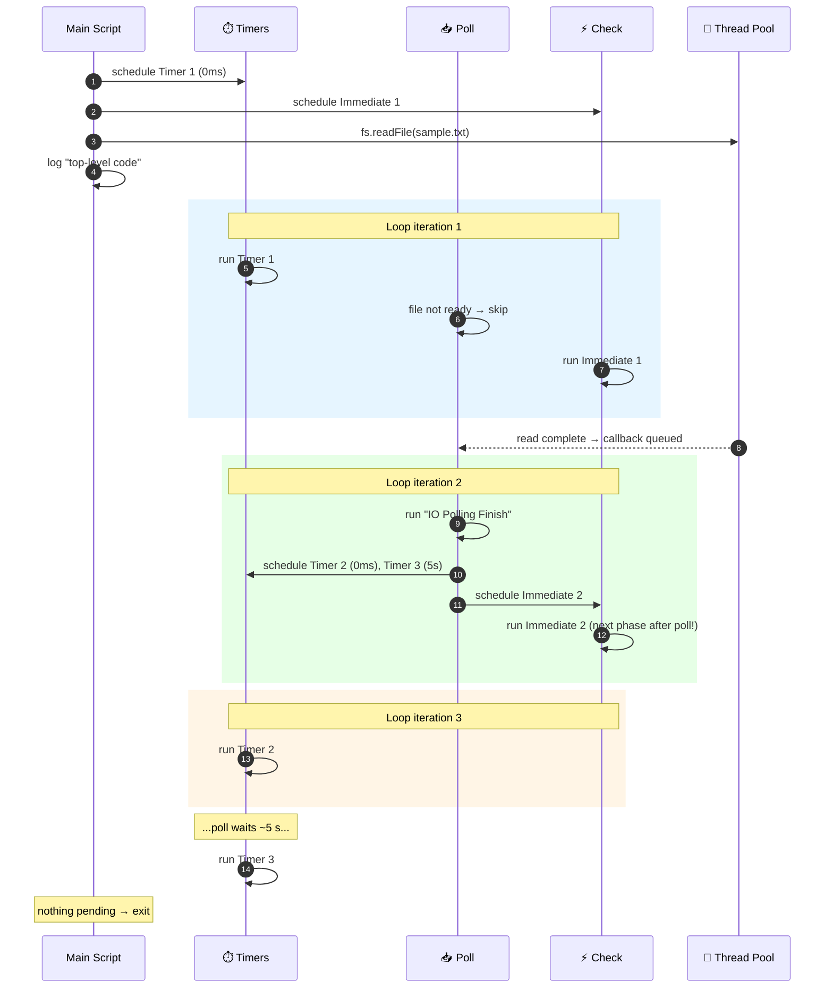

**Animated:** step through the code, the queues, and the console output together:

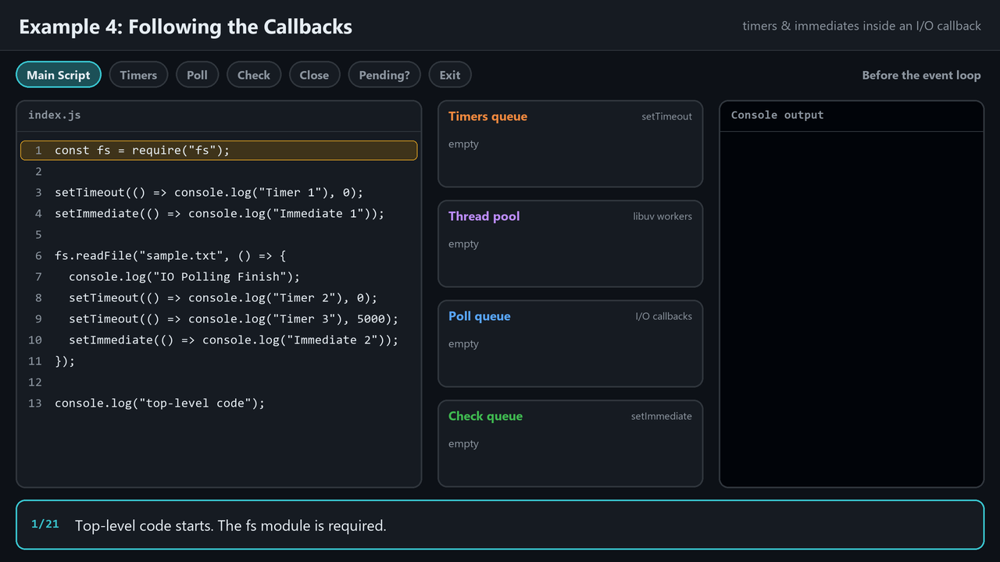

> [!IMPORTANT]
> **Rule:** inside an I/O cycle, `setImmediate()` **always** runs before `setTimeout(fn, 0)`, no matter how many timers exist. Outside an I/O cycle, the order is non-deterministic.

---

### Example 5: The ultimate ordering puzzle (with `nextTick` and Promises)

```js
const fs = require("fs");

console.log("1: script start");

setTimeout(() => console.log("6: setTimeout"), 0);
setImmediate(() => console.log("7: setImmediate"));
Promise.resolve().then(() => console.log("4: promise.then"));
process.nextTick(() => console.log("3: process.nextTick"));
queueMicrotask(() => console.log("5: queueMicrotask"));

fs.readFile(__filename, () => {
  console.log("8: readFile callback (poll)");
  setTimeout(() => console.log("11: timeout inside I/O"), 0);
  setImmediate(() => console.log("10: immediate inside I/O"));
  process.nextTick(() => console.log("9: nextTick inside I/O"));
});

console.log("2: script end");
```

**Output (verified on Node v24.11.0):**

```text
1: script start
2: script end
3: process.nextTick
4: promise.then
5: queueMicrotask
6: setTimeout
7: setImmediate
8: readFile callback (poll)
9: nextTick inside I/O
10: immediate inside I/O
11: timeout inside I/O
```

| Lines | Reason |
|---|---|
| 1–2 | Synchronous code always runs first |
| 3 | `nextTick` queue is drained first |
| 4–5 | Then the Promise microtask queue, in FIFO order |
| 6–7 | Timers phase, then check phase (*non-deterministic at top level*) |
| 8 | Poll phase picks up the finished file read |
| 9 | The `nextTick` queued inside the callback runs **right after that callback** |
| 10 | Check comes right after poll |
| 11 | Timers only on the next iteration |

---

## 7. Thread Pool Deep Dive

### 7.1 What goes to the thread pool?

The video calls these **"CPU-intensive tasks"**. Strictly speaking they fall into two groups, and both are offloaded:

| Category | Examples | Why the thread pool? |
|---|---|---|
| **CPU-intensive** | `crypto.pbkdf2`, `crypto.scrypt`, `crypto.randomBytes`, `crypto.generateKeyPair`, `zlib.gzip/deflate` | Heavy computation would **block** the main thread |
| **Blocking I/O** | All async `fs.*` operations, `dns.lookup()` | Many OSes have no reliable non-blocking file API, so libuv runs these on a worker thread |
| **NOT thread pool** | `http`, `net`, TCP/UDP sockets, `dns.resolve*()` | The OS kernel already handles these asynchronously (epoll / kqueue / IOCP) |

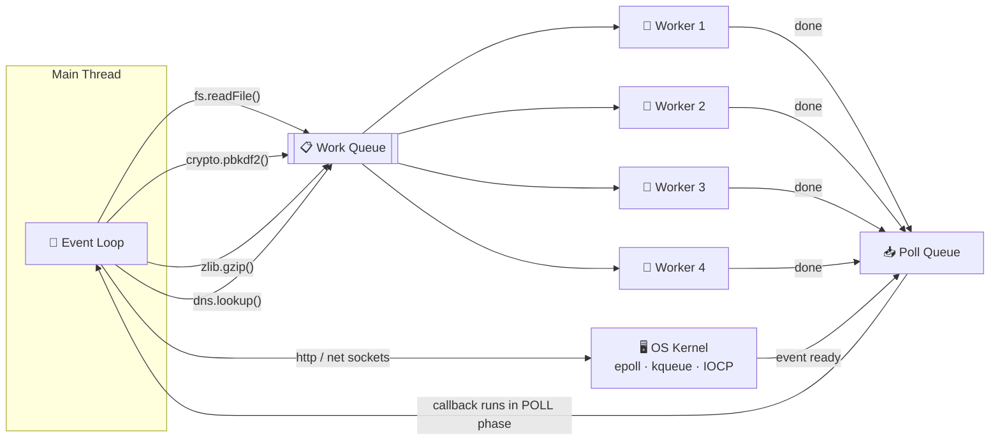

### 7.2 Thread pool size

| Setting | Value |
|---|---|
| **Default size** | **4 threads** |
| **Configured via** | The `UV_THREADPOOL_SIZE` environment variable |
| **Maximum** | **1024** in libuv ≥ 1.30 (Node 12+). The video's "128" was the older limit. |
| **Meaning** | The number of thread-pool tasks that can run **in parallel** |

### 7.3 Demo: hashing passwords with `crypto.pbkdf2`

```js
const crypto = require("crypto");

const start = Date.now();

crypto.pbkdf2("password1", "salt1", 100000, 1024, "sha512", () => {
  console.log(`Password 1 Done in ${Date.now() - start}ms`);
});
crypto.pbkdf2("password1", "salt1", 100000, 1024, "sha512", () => {
  console.log(`Password 2 Done in ${Date.now() - start}ms`);
});
crypto.pbkdf2("password1", "salt1", 100000, 1024, "sha512", () => {
  console.log(`Password 3 Done in ${Date.now() - start}ms`);
});
crypto.pbkdf2("password1", "salt1", 100000, 1024, "sha512", () => {
  console.log(`Password 4 Done in ${Date.now() - start}ms`);
});
crypto.pbkdf2("password1", "salt1", 100000, 1024, "sha512", () => {
  console.log(`Password 5 Done in ${Date.now() - start}ms`);
});
crypto.pbkdf2("password1", "salt1", 100000, 1024, "sha512", () => {
  console.log(`Password 6 Done in ${Date.now() - start}ms`);
});
```

#### Results (absolute times depend on your CPU, but the pattern does not)

**Default pool (4 threads), 6 tasks.** Tasks finish in **two waves**:

```text
Password 1 done in 2701ms   ┐
Password 2 done in 2798ms   │ wave 1: 4 tasks run in parallel
Password 4 done in 3040ms   │
Password 3 done in 3202ms   ┘
Password 5 done in 5093ms   ┐ wave 2: had to WAIT for a free thread
Password 6 done in 5142ms   ┘ (~2× the time)
```

**`UV_THREADPOOL_SIZE=2`, 6 tasks.** Tasks finish in **three waves**:

```text
Password 2 done in 2634ms   ┐ wave 1
Password 1 done in 2752ms   ┘
Password 3 done in 5397ms   ┐ wave 2
Password 4 done in 5423ms   ┘
Password 6 done in 8090ms   ┐ wave 3
Password 5 done in 8342ms   ┘
```

**`UV_THREADPOOL_SIZE=10`, 6 tasks.** All 6 finish at roughly the **same time**, in one wave.

**`UV_THREADPOOL_SIZE=1`.** Every task runs one after another, so each finishes later than the previous one.

#### Visualizing the waves (4 threads, 6 tasks)

```mermaid
gantt
    title Thread Pool Scheduling — 4 threads, 6 pbkdf2 tasks
    dateFormat X
    axisFormat %s
    section 🧵 Thread 1
    Password 1   :a1, 0, 6
    Password 5   :a5, 6, 12
    section 🧵 Thread 2
    Password 2   :a2, 0, 6
    Password 6   :a6, 6, 12
    section 🧵 Thread 3
    Password 3   :a3, 0, 6
    section 🧵 Thread 4
    Password 4   :a4, 0, 6
```

**Animated** (timings taken from the real run above):

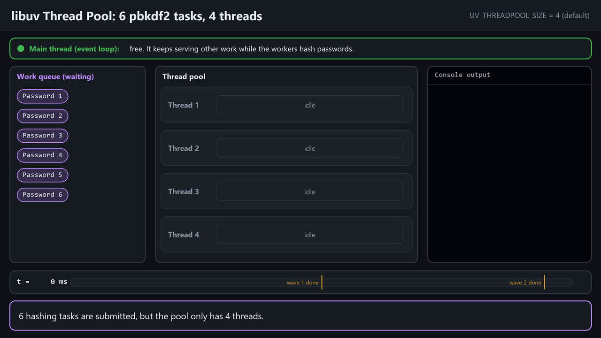

### 7.4 Changing the pool size

```bash
# ✅ Recommended: set it before the process starts
UV_THREADPOOL_SIZE=8 node index.js            # macOS / Linux / Git Bash
$env:UV_THREADPOOL_SIZE=8; node index.js      # Windows PowerShell
set UV_THREADPOOL_SIZE=8 && node index.js     # Windows CMD
```

```js
// ⚠️ Also works (shown in the video), but ONLY if it is the very first line,
// before anything touches the thread pool. libuv creates the pool lazily on first use.
process.env.UV_THREADPOOL_SIZE = 8;

const crypto = require("crypto");
// ...
```

> [!CAUTION]
> More threads is **not** always faster. If you have more threads than CPU cores, CPU-bound work just gets time-sliced, and each thread uses memory. A reasonable starting point is about the number of CPU cores (`os.availableParallelism()`), then benchmark. For heavy CPU work in your own JavaScript, use **`worker_threads`** instead: the libuv pool only runs Node's built-in native operations.

### 7.5 The golden rule: don't block the event loop

```js
// ❌ BLOCKS the main thread. Every other request waits.
const hash = crypto.pbkdf2Sync("pwd", "salt", 100000, 1024, "sha512");

// ✅ Offloaded to the thread pool. The main thread stays free.
crypto.pbkdf2("pwd", "salt", 100000, 1024, "sha512", (err, hash) => { /* ... */ });
```

---

## 8. Node.js vs. Thread-per-Request Servers (PHP)

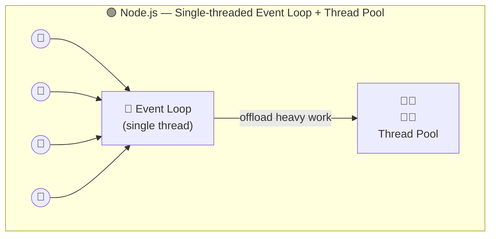

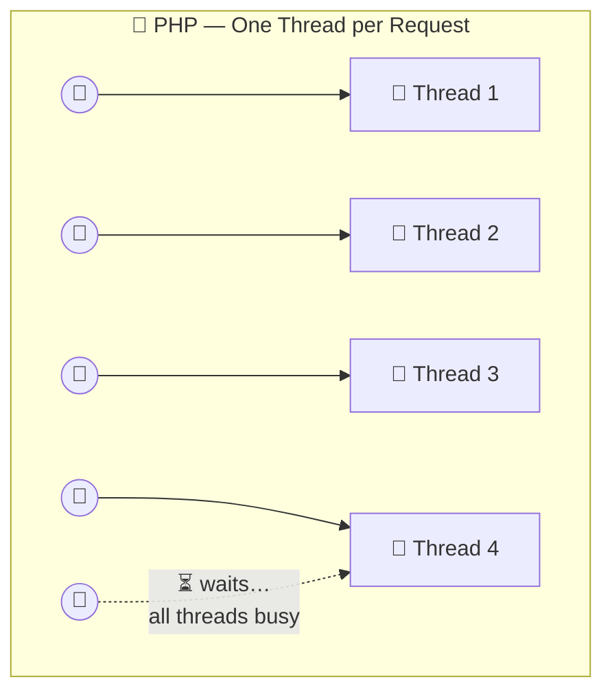

| Aspect | Node.js | PHP (classic thread/process-per-request) |
|---|---|---|
| Concurrency model | One event loop handles **all** requests | One thread or process per request |
| Idle I/O wait | Costs nothing, because the loop serves other requests | The thread sits blocked and does nothing |
| Under heavy load | Scales well for I/O-bound work | *"At one particular time, all threads are busy"*, so new users **wait** |
| CPU-heavy work | Weak spot. Offload to the thread pool, `worker_threads`, or other services | Handled naturally per thread |
| Best fit | REST APIs, real-time apps, streaming, microservices | CPU-heavy per-request computation |

**The hybrid approach recommended in the video:**

> Build your **REST API / I/O-heavy services in Node.js**. Delegate **CPU-intensive work** to separate **microservices** written in a language with strong multithreading. This combines the strengths of both.

---

## 9. Summary and Key Takeaways

### Architecture

- Node.js is a **runtime environment**, not a language, built on **V8 + libuv**.
- **V8** (C++) parses, compiles (JIT), and executes JavaScript, and manages the **heap** and **call stack**.
- **libuv** (C) provides the **event loop** and the **thread pool**, and abstracts OS differences (epoll / kqueue / IOCP).

### Startup

- `node index.js` creates a **Node process** with a **single main thread**.
- Order: **Init, then Top-Level Code, then Require Modules, then Register Callbacks, then Start Event Loop.**

### Event Loop

- Six phases: **Timers, Pending, Idle/Prepare, Poll, Check, Close.**
- Each phase has its own **FIFO queue**.
- **Poll** is where I/O callbacks run, and where the loop **waits** when there is nothing else to do.
- When nothing is pending, the process **exits**.

### Microtasks

- **`process.nextTick`** has the highest priority, then **Promises / `queueMicrotask`**.
- Since **Node 11**, microtasks drain **after every callback**, not just between phases.
- Recursive `nextTick` can **starve** I/O.

### Ordering rules

- `setTimeout(fn, 0)` vs `setImmediate()` at **top level** is **non-deterministic**.
- **Inside an I/O callback**, `setImmediate()` **always** runs first.
- `setTimeout(fn, 0)` is actually a **1 ms** minimum delay.

### Thread Pool

- Default **4 threads**, configurable through **`UV_THREADPOOL_SIZE`** (max 1024).
- Used for **fs, crypto (pbkdf2/scrypt/randomBytes), zlib, `dns.lookup`**.
- **Network I/O does NOT use the thread pool.** The OS handles it.
- More tasks than threads means tasks **queue up and wait** (the second wave in the demo).

### Design guidance

- Node.js is excellent for **I/O-bound** workloads such as APIs and real-time apps.
- **Never block the event loop**: avoid `*Sync` APIs and heavy loops in request handlers.
- Use a **hybrid architecture**: Node.js for APIs, other services or worker threads for CPU-heavy work.

---

### 📚 Further Reading

- [The Node.js Event Loop, Timers, and `process.nextTick()`](https://nodejs.org/learn/asynchronous-work/event-loop-timers-and-nexttick)
- [Don't Block the Event Loop (or the Worker Pool)](https://nodejs.org/learn/asynchronous-work/dont-block-the-event-loop)
- [Understanding `setImmediate()`](https://nodejs.org/learn/asynchronous-work/understanding-setimmediate)
- [Understanding `process.nextTick()`](https://nodejs.org/learn/asynchronous-work/understanding-processnexttick)
- [libuv Design Overview](https://docs.libuv.org/en/v1.x/design.html)
