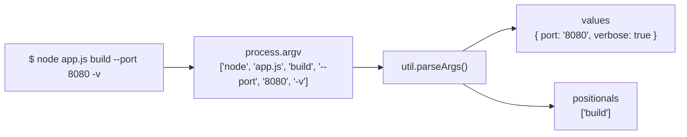
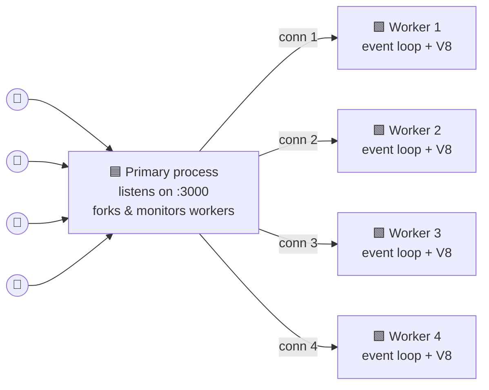
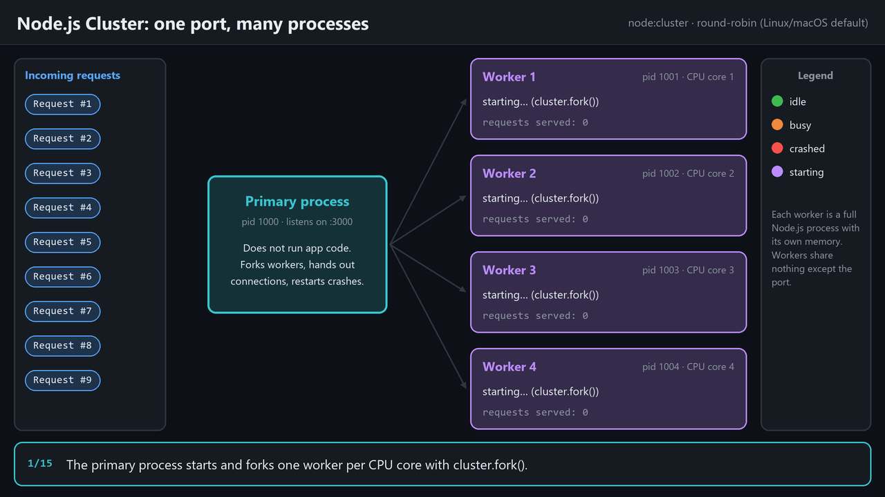
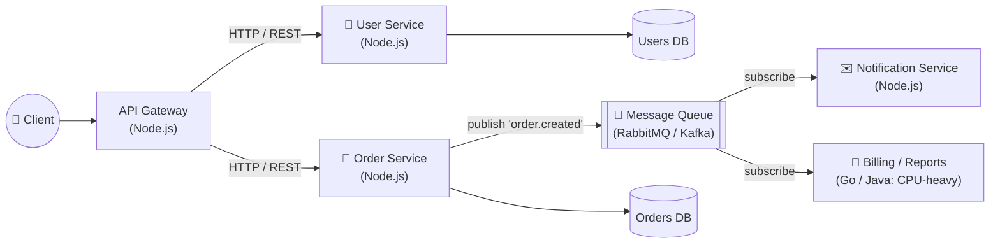
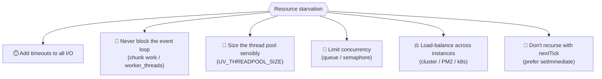
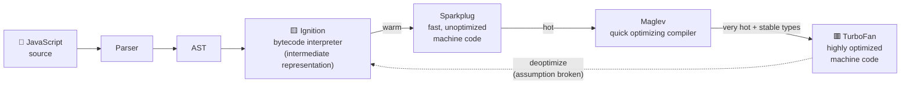
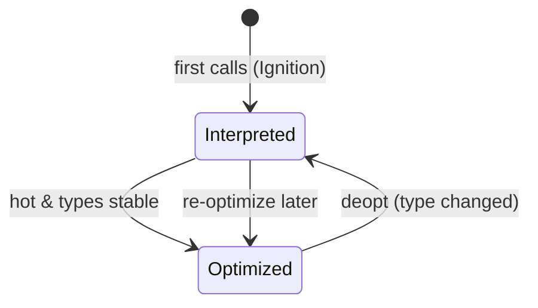

# Node.js Concepts, Part 2: CLI, Clustering, Microservices, Starvation and V8 JIT

> A companion to [nodejs-architecture-deep-dive.md](nodejs-architecture-deep-dive.md). It is kept short and practical, with one idea and one example per concept.
>
> **Verified on:** Node.js `v24.11.0`. The outputs shown came from actually running the code.

## Table of Contents

1. [Processing Command-Line Arguments](#1-processing-command-line-arguments)
2. [Clustering: Running Multiple Instances](#2-clustering-running-multiple-instances)
3. [Why Node.js Fits Microservices](#3-why-nodejs-fits-microservices)
4. [Preventing Resource Starvation](#4-preventing-resource-starvation)
5. [V8 and Just-In-Time (JIT) Compilation](#5-v8-and-just-in-time-jit-compilation)
6. [Quick Revision](#6-quick-revision)

---

## 1. Processing Command-Line Arguments

### 1.1 The raw way: `process.argv`

`process.argv` is an array of strings:

| Index | Value |
|---|---|
| `0` | Path to the `node` executable |
| `1` | Path to the script being run |
| `2+` | **Your arguments** |

```js
// app.js
console.log(process.argv.slice(2));
```

```bash
$ node app.js build --port 8080 -v
[ 'build', '--port', '8080', '-v' ]
```

Everything arrives as a **plain string**, so you would have to parse flags, values and types yourself.

### 1.2 The built-in parser: `util.parseArgs()` (recommended)

Node.js (v18.3+ / v16.17+) ships with a parser, so no library is needed:

```js
// app.js
const { parseArgs } = require("node:util");

const { values, positionals } = parseArgs({
  options: {
    port:    { type: "string",  short: "p", default: "3000" },
    verbose: { type: "boolean", short: "v", default: false },
  },
  allowPositionals: true,
});

console.log(values, positionals);
```

```bash
$ node app.js build --port 8080 -v
[Object: null prototype] { port: '8080', verbose: true } [ 'build' ]
```



> [!TIP]
> Values are still strings. Convert them yourself, for example `Number(values.port)`. Unknown flags throw an error by default (`strict: true`), which protects you from typos.

### 1.3 Other options

| Approach | When to use |
|---|---|
| `process.argv` | Tiny scripts with one or two arguments |
| `util.parseArgs()` | Most CLIs, with zero dependencies |
| `yargs` / `commander` (npm) | Full CLIs with sub-commands, auto-generated `--help`, and validation |
| Environment variables (`process.env.PORT`) | Configuration and secrets, rather than per-run flags |

```bash
PORT=8080 node app.js          # read with: process.env.PORT
node --env-file=.env app.js    # load a .env file (built in since Node 20.6)
```

---

## 2. Clustering: Running Multiple Instances

### 2.1 The problem

A single Node.js process runs your JavaScript on **one thread**, so it uses **one CPU core**. On an 8-core server, 7 cores sit idle.

### 2.2 The solution: the `node:cluster` module

The **primary** process forks several **worker** processes (usually one per core). All workers **share the same port**, and incoming connections are spread across them.



**Animated:** connections handed out in turn, and a crashed worker automatically replaced:



### 2.3 Example

```js
// server.js
const cluster = require("node:cluster");
const http = require("node:http");
const os = require("node:os");

if (cluster.isPrimary) {
  const numWorkers = os.availableParallelism(); // number of CPU cores
  console.log(`Primary ${process.pid} starting ${numWorkers} workers`);

  for (let i = 0; i < numWorkers; i++) cluster.fork();

  // Self-healing: replace any worker that dies
  cluster.on("exit", (worker, code) => {
    console.log(`Worker ${worker.process.pid} died (code ${code}). Starting a new one...`);
    cluster.fork();
  });
} else {
  http
    .createServer((req, res) => res.end(`Handled by worker ${process.pid}\n`))
    .listen(3000);
}
```

```bash
$ node server.js
Primary 42612 starting 20 workers       # 20 = cores on the test machine
```

```bash
# Illustrative (Linux/macOS round-robin): each new connection goes to the next worker
$ curl localhost:3000   →  Handled by worker 23748
$ curl localhost:3000   →  Handled by worker 16520
```

> On the Windows test machine, all requests from one `fetch` client went to the **same** worker. Windows lets the OS pick the worker, and `fetch` reuses one keep-alive connection.

### 2.4 Key points

| Point | Detail |
|---|---|
| Workers are **processes**, not threads | Each has its own memory, event loop and V8 instance. **No shared variables.** |
| Load balancing | **Round-robin** by the primary on Linux/macOS. On **Windows** the OS decides which worker accepts the connection. |
| Keep-alive | A client that reuses one connection (keep-alive) keeps hitting the **same** worker |
| State | Store sessions and caches in **Redis or a database**, not in process memory |
| Crash isolation | One worker crashing does not take down the others |
| Production | **PM2** (`pm2 start server.js -i max`), or containers plus Kubernetes, do the same job with less code |

> [!NOTE]
> **Cluster vs. `worker_threads`:** use **cluster** to scale an HTTP server across cores. Use **`worker_threads`** to offload CPU-heavy JavaScript (image processing, parsing big files) inside one process.

---

## 3. Why Node.js Fits Microservices

> Node.js is a great fit because its **event-driven programming model** and **efficiency with I/O-bound tasks** let it handle many different requests and communicate between services effectively.

A microservice spends most of its time **waiting**: for the database, for other services, for message queues. That is exactly where Node.js shines. While one request waits on I/O, the event loop serves other requests.



**Why it works well:**

| Strength | Why it matters for services |
|---|---|
| Non-blocking I/O | One small process handles thousands of concurrent calls to other services |
| Event-driven | Fits naturally with message queues, WebSockets and webhooks |
| Lightweight and fast startup | Small containers that scale up and down quickly |
| JSON-native | Services talk in JSON, which JavaScript handles natively |
| Same language as the frontend | Shared types and validation, and one team can own the whole stack |

**A tiny service calling another service** (waiting costs the event loop nothing):

```js
// order-service.js
const http = require("node:http");

http.createServer(async (req, res) => {
  // Both calls run concurrently; the event loop is free while they're in flight
  const [user, stock] = await Promise.all([
    fetch("http://user-service:4001/users/42").then((r) => r.json()),
    fetch("http://inventory-service:4002/stock/99").then((r) => r.json()),
  ]);
  res.setHeader("Content-Type", "application/json");
  res.end(JSON.stringify({ user, stock, status: "order placed" }));
}).listen(4000);
```

> [!CAUTION]
> Delegate **CPU-heavy** services (video encoding, ML, heavy reports) to `worker_threads` or to a language built for parallel computation. A blocked event loop blocks **every** request on that instance.

---

## 4. Preventing Resource Starvation

**Resource starvation** happens when some work never gets the CPU time, threads or connections it needs. In Node.js the usual causes are:

| Cause | Symptom |
|---|---|
| A long synchronous task blocks the event loop | **Every** request stalls |
| An I/O call hangs forever (no timeout) | Sockets, memory and pool slots leak until the app hangs |
| Too many tasks for the thread pool (default 4) | `fs` and `crypto` calls queue up and latency spikes |
| Recursive `process.nextTick()` / endless Promise chains | The loop never reaches the poll phase, so **I/O starves** |
| One overloaded instance | Slow responses while other cores or machines sit idle |



### 4.1 Put a timeout on every I/O call, and handle the failure gracefully

```js
async function getUser(id) {
  try {
    const res = await fetch(`https://api.example.com/users/${id}`, {
      signal: AbortSignal.timeout(2000), // give up after 2 s
    });
    return await res.json();
  } catch (err) {
    if (err.name === "TimeoutError") return { id, fallback: true }; // degrade, don't hang
    throw err;
  }
}
```

Verified behavior when the remote host never answers:

```text
TimeoutError - The operation was aborted due to timeout
```

Also set timeouts on servers and database pools:

```js
server.requestTimeout = 30_000;   // http.Server: drop requests that take too long
// e.g. pg: new Pool({ max: 20, connectionTimeoutMillis: 2000, idleTimeoutMillis: 10000 })
```

### 4.2 Don't block the event loop: split big work into chunks

```js
// ❌ Starves everything: 10 million iterations in one go
for (let i = 0; i < 1e7; i++) heavyStep(i);

// ✅ Yield to the event loop between chunks so I/O can still run
function processInChunks(start = 0, chunk = 100_000) {
  const end = Math.min(start + chunk, 1e7);
  for (let i = start; i < end; i++) heavyStep(i);
  if (end < 1e7) setImmediate(() => processInChunks(end, chunk)); // let poll phase breathe
}
processInChunks();
```

For truly heavy CPU work, move it to `worker_threads`.

### 4.3 Manage the thread pool and concurrency

```bash
UV_THREADPOOL_SIZE=8 node server.js   # default is 4; size it to the workload and CPU cores
```

```js
// Cap how many expensive tasks run at once (a simple semaphore)
const MAX = 4;
let active = 0;
const queue = [];

async function limited(task) {
  if (active >= MAX) await new Promise((resolve) => queue.push(resolve));
  active++;
  try { return await task(); }
  finally { active--; queue.shift()?.(); }
}

// usage: await limited(() => hashPassword(pwd));
```

### 4.4 Load-balance across instances

- One machine: use **cluster** or **PM2** (`pm2 start app.js -i max`). See [section 2](#2-clustering-running-multiple-instances).
- Many machines: put **Nginx, a cloud load balancer, or Kubernetes** in front of several instances.

---

## 5. V8 and Just-In-Time (JIT) Compilation

> V8 uses **JIT compilation**. It parses JavaScript into a lower-level **intermediate representation** (bytecode), runs it quickly in an unoptimized form, and when a function runs **often** ("hot"), passes it to an **optimizing compiler** that generates much faster machine code.

### 5.1 The pipeline



| Tier | Speed to compile | Speed of resulting code | Purpose |
|---|---|---|---|
| **Ignition** (interpreter) | Instant | Slowest | Start running immediately, and collect type feedback |
| **Sparkplug** (baseline) | Very fast | Faster | Cheap unoptimized machine code |
| **Maglev** (mid-tier) | Fast | Fast | Good optimization at low cost |
| **TurboFan** (top tier) | Slow | **Fastest** | Aggressive optimization of hot, type-stable code |

### 5.2 Seeing it happen: optimization, then deoptimization

```js
// jit.js
function add(a, b) { return a + b; }

for (let i = 0; i < 1e6; i++) add(i, 1);   // always numbers → gets optimized
add("x", "y");                              // a string! the optimized code's assumption breaks
for (let i = 0; i < 1e6; i++) add(i, 1);
```

```bash
$ node --trace-opt --trace-deopt jit.js
```

Real output, trimmed:

```text
[marking <JSFunction add> for optimization to MAGLEV, reason: hot and stable]
[completed compiling <JSFunction add> (target MAGLEV)]
[marking <JSFunction add> for optimization to TURBOFAN_JS, reason: hot and stable]
[completed optimizing <JSFunction add> (target TURBOFAN_JS)]
[bailout (kind: deopt-eager, reason: not a Smi): begin. deoptimizing <JSFunction add>]
```

- **"hot and stable"**: `add` ran many times with the same types, so V8 optimized it (first Maglev, then TurboFan).
- **"deopt … not a Smi"**: the optimized code assumed small integers (Smi). Passing strings broke that assumption, so V8 threw the fast code away and fell back to the interpreter.



### 5.3 Writing JIT-friendly code

```js
// ✅ Consistent types and object shapes → stays optimized
function area(rect) { return rect.w * rect.h; }
area({ w: 2, h: 3 });
area({ w: 5, h: 1 });

// ❌ Changing types / shapes → deopts
area({ w: "2", h: 3 });       // string instead of number
area({ h: 3, w: 2, z: 1 });   // different property order / extra property = new hidden class
```

- Keep function argument types **consistent**.
- Initialize all object properties in the **same order** (ideally in the constructor).
- Avoid `delete obj.prop`. Set it to `undefined` instead.

---

## 6. Quick Revision

- **CLI args:** `process.argv.slice(2)` gives the raw strings. `util.parseArgs()` is the built-in parser. Use `yargs`/`commander` for big CLIs and `process.env` for config.
- **Clustering:** `node:cluster` forks one worker **process** per core, all sharing a port. The primary load-balances (round-robin on Linux/macOS) and restarts crashed workers. Keep state in Redis or a DB. PM2 does it for you.
- **Microservices:** Node's event-driven, non-blocking I/O makes it ideal for I/O-bound services that talk over HTTP or message queues. Delegate CPU-heavy work elsewhere.
- **Resource starvation:**
  - Put **timeouts** on all I/O (`AbortSignal.timeout`) and fail gracefully.
  - **Don't block** the loop: chunk work with `setImmediate`, or use `worker_threads`.
  - Tune **`UV_THREADPOOL_SIZE`** and **limit concurrency**.
  - **Load-balance** across instances.
- **V8 JIT:** source is parsed to an AST, then Ignition runs it as bytecode. Warm code goes to Sparkplug, hot code to Maglev, then TurboFan. Type changes trigger a **deopt**. Consistent types and object shapes keep code fast.
